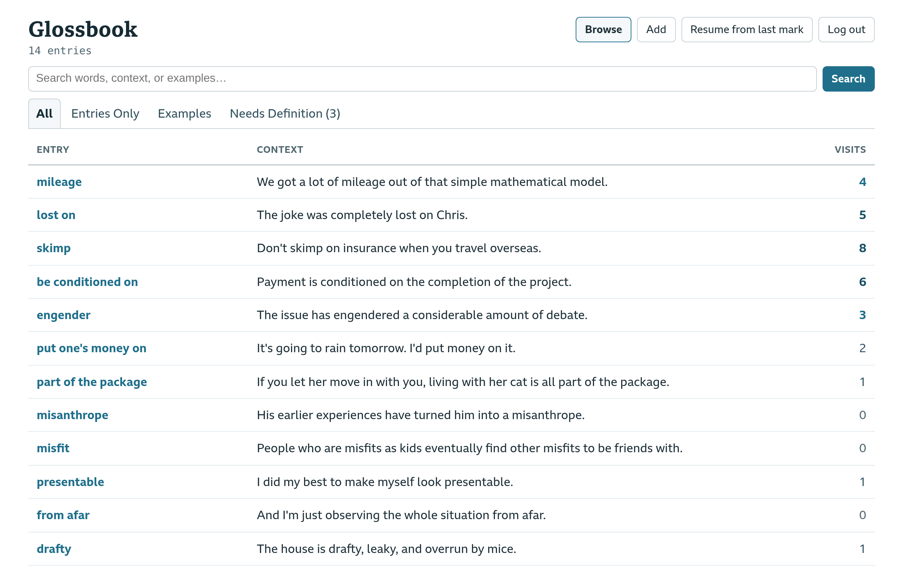
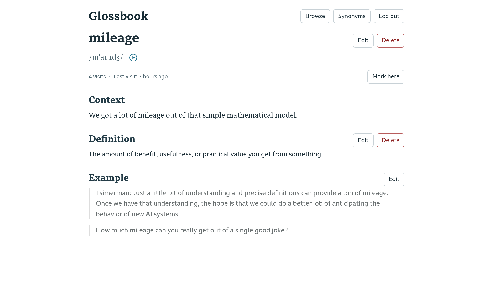

# My Dictionary

[中文说明](README.zh-CN.md)

A personal vocabulary web app for IELTS study, built with FastAPI and SQLite. Add words and phrases, write your own definitions in Markdown, attach usage examples, and review them later — with phonetic transcription, thesaurus lookups, and a built-in Markdown notes browser thrown in.




## Features

- **Entries & definitions** — add words/phrases, attach one or more Markdown-formatted definitions and an example sentence
- **IPA transcription** — automatic phonetic transcription of each word via [phonemizer](https://github.com/bootphon/phonemizer)
- **Thesaurus lookup** — pull synonyms and sense definitions from the Merriam-Webster Thesaurus API
- **Review bookmark** — mark your place in the entry list and jump back to it later
- **Visit tracking** — each entry tracks visit count and last-visited time
- **Multiple views** — browse all entries, entries-only, or entries with examples
- **Notes section** — browse and edit a folder of Markdown notes (e.g. IELTS study notes) with a generated table of contents
- **Markdown editing** — entries, definitions, examples, and notes are all edited with [EasyMDE](https://github.com/Ionaru/easy-markdown-editor)

## Tech stack

- [FastAPI](https://fastapi.tiangolo.com/) + [Jinja2](https://jinja.palletsprojects.com/) templates
- [SQLAlchemy](https://www.sqlalchemy.org/) ORM over SQLite
- [markdown2](https://github.com/trentm/python-markdown2) for rendering Markdown content
- [phonemizer](https://github.com/bootphon/phonemizer) for IPA transcription
- Vanilla JS + [EasyMDE](https://github.com/Ionaru/easy-markdown-editor) on the frontend

## Setup

Requires Python 3.12+.

1. Install dependencies (via [uv](https://github.com/astral-sh/uv) or pip):

   ```bash
   uv sync
   # or
   pip install -r requirements.txt
   ```

   IPA transcription also requires the `espeak-ng` backend:

   ```bash
   sudo apt-get install espeak-ng
   ```

2. Copy the example config and fill in your values:

   ```bash
   cp config.toml.example config.toml
   ```

   - `notes_folder` — a local directory of Markdown notes to browse under `/notes/`
   - `mw_thesaurus_api_key` — a free API key from the [Merriam-Webster Developer Center](https://dictionaryapi.com/) (used for the synonyms feature)

3. Configure the administrator account. Generate an Argon2 password hash and
   a random session secret:

   ```bash
   uv run python -c "from pwdlib import PasswordHash; print(PasswordHash.recommended().hash(input('Admin password: ')))"
   uv run python -c "import secrets; print(secrets.token_urlsafe(48))"
   ```

   Add the resulting values to the `[auth]` section of `config.toml`:

   ```toml
   [auth]
   admin_username = "admin"
   admin_password_hash = "$argon2id$..."
   session_secret = "the-random-session-secret"
   https_only = true
   ```

   Production uses secure HTTPS-only session cookies. For an HTTP-only
   local-network test, temporarily set `https_only = false`; never use that
   value on the public deployment. The `DICTIONARY_*` environment variables
   remain optional overrides for deployments that prefer them.

4. Create the database tables:

   ```bash
   python database.py create-table
   ```

5. Run the app:

   ```bash
   uvicorn main:app --reload
   ```

   Then open `http://localhost:8000`.

   To test from another device on the same trusted local network:

   ```bash
   export DICTIONARY_HTTPS_ONLY=false
   uvicorn main:app --host 0.0.0.0 --port 8000
   ```

   Open `http://<computer-lan-ip>:8000`. Restore
   `DICTIONARY_HTTPS_ONLY=true` (or remove the override) for production.

## Access control

- Browsing entries, viewing entry details, synonyms, and quizzes is public.
- Adding, editing, deleting, review bookmarks, and all notes routes require
  the administrator session.
- Every state-changing request also requires a CSRF token.
- Anonymous browsing and quizzes do not update visit counters, keeping public
  access read-only.
- FastAPI's `/docs`, `/redoc`, and `/openapi.json` endpoints are disabled.

## Notes

- Data is stored locally in `dictionary.db` (SQLite) and is not tracked in git.
